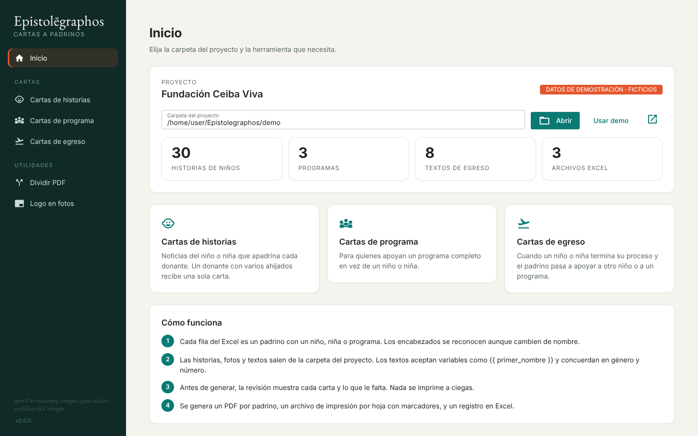
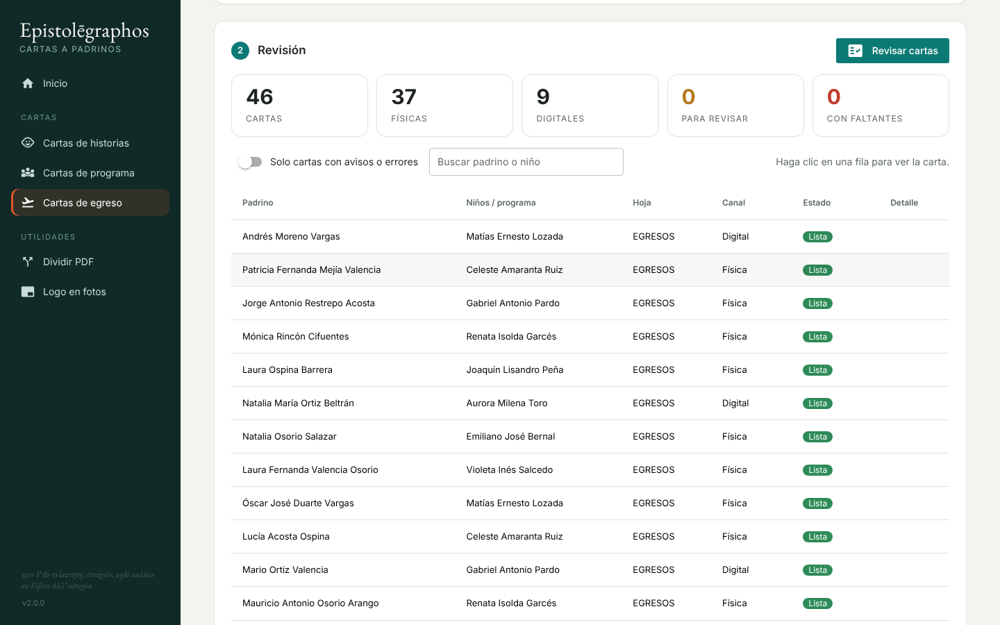
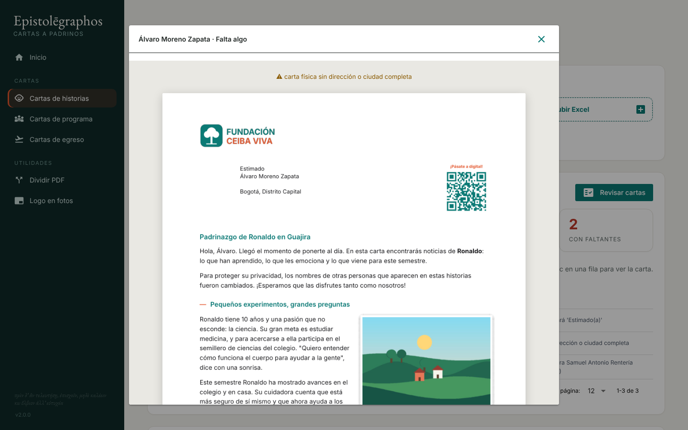
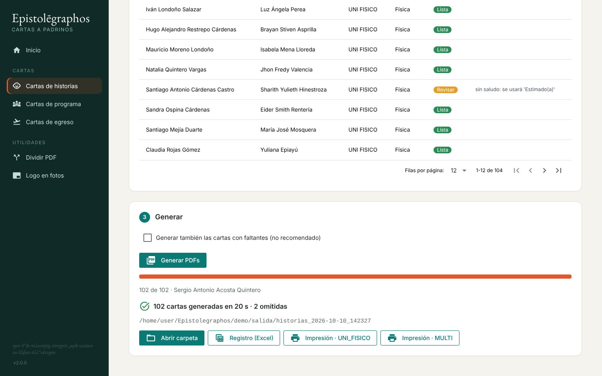
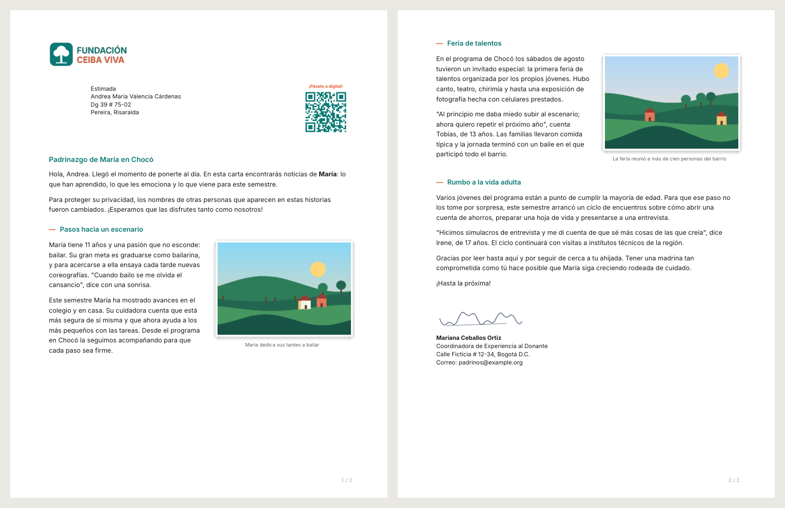

# Epistolēgraphos

**Personalised donor letters, from a spreadsheet and a folder of stories.**

A child-sponsorship NGO writes to its donors twice a year: news about the child they sponsor,
updates from the program, or a note when a child finishes the program and the donor is introduced
to someone new. With thousands of donors, every letter is different: a different child, photos,
program and address, and greetings and wording that must agree with the donor's and the children's
gender and number.

Epistolēgraphos builds those letters. The input is the CRM's Excel export plus a project folder with the
stories, photos, texts and brand assets. The output is one print-ready PDF per donor, a merged
print file with bookmarks, and an Excel log of what happened to every row.

> Version 1 was a set of Python scripts I wrote that produced the letters for a real
> organisation for a year (see [`legacy/`](legacy/)). This version 2 is a rewrite of that tool
> for my portfolio. **All data in this repository is fictional**: the foundation, the donors, the
> children, the stories and the pictures were generated by [`scripts/crear_demo.py`](scripts/crear_demo.py).



## What it does

| Tool | |
|---|---|
| **Cartas de historias** | News about the sponsored child or children. A donor with several sponsored children gets **one** letter that covers all of them, grouped by program. |
| **Cartas de programa** | For donors who sponsor a whole program instead of a child. |
| **Cartas de egreso** | A child finishes the program; the letter says goodbye and introduces the new child or program. |
| **Dividir PDF** | Splits a merged print PDF into one file per donor, using bookmarks or by finding each name on the page. |
| **Logo en fotos** | Stamps the logo on a batch of photos (respects phone rotation; never overwrites the originals). |

### Review before generating

Every letter is built in memory first. The review step shows what would go wrong before any PDF is
written: a child without a story, a physical letter without an address, a template variable that
does not exist, a missing greeting. Click any row to see the actual letter.




### Generate

Letters are rendered in parallel (about 100 letters in 20 s on a laptop). The output folder holds:

```
salida/historias_2026-10-10_142327/
├── registro.xlsx                    one row per donor: status, children, pages, file
└── historias/UNI_FISICO/
    ├── impresion_fisicas.pdf        every physical letter of the sheet, one bookmark per donor
    ├── fisicas/<Donor (id)>.pdf
    └── digitales/<Donor (id)>.pdf
```



### The letters



## Running it

Requires Python 3.11+.

```bash
pip install -r requirements.txt
python -m epistolegraphos          # opens http://localhost:8080
python -m pytest                   # tests
python scripts/crear_demo.py       # rebuilds the fictional demo project
```

On Windows, `iniciar.bat` creates a virtual environment the first time and starts the app.
WeasyPrint needs the Pango libraries on Windows; see the
[WeasyPrint install guide](https://doc.courtbouillon.org/weasyprint/stable/first_steps.html#windows).

## How a project is organised

The app works on a project folder (the [`demo/`](demo/) folder is one). Non-programmers edit
everything in it with a text editor and a file explorer:

```
proyecto.json                         organisation name, signer, colours
datos/*.xlsx                          CRM exports, one sheet per batch
textos/historias_intro.md             intro and closing paragraphs (Markdown + variables)
historias/ninos/<Program>/<Child full name>.md  (+ .jpg photo, + .txt caption)
historias/programas/<Program>/01 <title>.md     (+ photo, + caption)
historias/egresos/<Child full name>.md
marca/logo.png, firma.png, qr.png
plantillas/                           optional: overrides the letter HTML/CSS
```

A story file can hold several sections, each starting with `# Title`.

### Texts with grammar

The texts are Jinja templates. Besides names and places they get helpers for Spanish agreement:

```markdown
Gracias por seguir de cerca a {{ ahijado }}.            → "tu ahijada" / "tus ahijados" / "tu ahijado(a)"
Tener {{ gp('un padrino', 'una madrina') }} como tú...  → agrees with the donor (from the greeting)
{{ ninos }} siguensigue creciendo
                                                         → "Ana, Luis e Isabel siguen creciendo"
```

Lists use the right conjunction (*Juan **e** Isabel*, *siete **u** ocho*). Names arrive from the CRM
in any case (`MARTHA LUCÍA  GÓMEZ` → `Martha Lucía Gómez`), and program names are written so the
sentence reads well (`Tumaco - Fortalecimiento Familiar` → *programa de Fortalecimiento Familiar en Tumaco*).
A misspelt variable stops that letter and shows up in the review; it is never printed into the letter.

## Design notes: what changed from version 1

Version 1 worked, and it taught me where this kind of tool breaks:

- **Names are not identifiers.** v1 found a child's story by searching the whole folder for the
  name, so two children called *María José* could get each other's story. It also grouped donors
  by name, so two donors with the same name were merged. v2 groups donors by CRM contact ID and
  looks for a story inside the child's program folder first. When a name is ambiguous, v2 reports
  it instead of guessing.
- **Failures were silent.** A missing story produced a letter without it, logged as "OK", and a
  template typo was printed into the letter. v2 builds every letter first and shows the problems.
  Letters with errors are not generated unless you choose to.
- **One engine.** Single-donor, multi-donor and departure letters were three scripts with copied
  helpers that had already drifted apart (one matched file names ignoring case, another did not).
  Now there is one model (`cartas.py`) and one renderer (`render.py`).
- **The CRM's headers change.** `Dirección`, `Direccion `, `dirección`, `nombre_completo_padrino`…
  every header is normalised and mapped to one field (`datos.py`).
- **Speed.** v1 searched the disk several times for every letter. v2 indexes the folder once and renders in
  parallel.
- **Splitting printed PDFs** assumed every letter had exactly two pages. v2 uses bookmarks, or finds
  where each donor's letter starts, so letters can be any length.

## Code map

| File | |
|---|---|
| `epistolegraphos/datos.py` | Excel reading, header aliases, digital/physical detection |
| `epistolegraphos/gramatica.py` | Spanish helpers: lists, gender/number agreement, name casing |
| `epistolegraphos/proyecto.py` | Project folder, story index, story file parsing |
| `epistolegraphos/cartas.py` | Rows → letter models, with errors and warnings |
| `epistolegraphos/render.py` | HTML → PDF (WeasyPrint), parallel batch, print file, log |
| `epistolegraphos/utilidades.py` | PDF splitter and logo stamper |
| `epistolegraphos/interfaz.py` | Web interface (NiceGUI) |
| `epistolegraphos/plantillas/` | Letter HTML and CSS |

Built with Python, NiceGUI, WeasyPrint, Jinja2, pandas, PyMuPDF and RapidFuzz.
